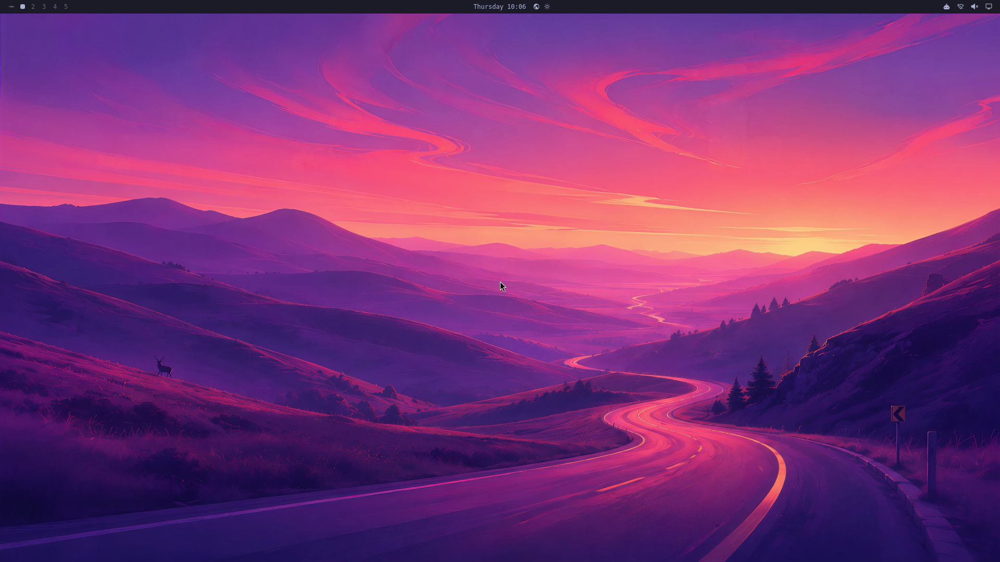
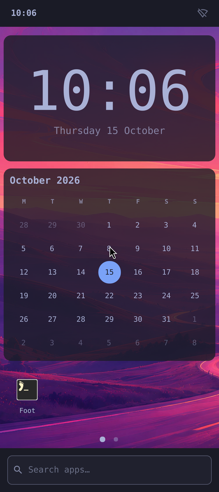

# Omarchy Mobile on Android

**Built on [Omarchy](https://github.com/omacom/omarchy),
[Omarchy Mobile](https://github.com/derekross/omarchy-mobile) and
[TAWC](https://github.com/wmww/tawc), with
[Taowen's Android Hyprland port](https://github.com/taowen/anhyprland).**
These projects and their contributors provide the foundation.
[Full credits and source acknowledgements](CREDITS.md).

Run a real Omarchy desktop and Omarchy Mobile on an existing Android device, with
one shared Linux installation. The phone uses the upstream touch shell and
widgets; an external Android display uses genuine Hyprland and Omarchy's desktop
shell. Linux applications, packages, home files, plugins and themes are shared.

This is an independent integration prototype. It is not an official Omarchy
release. Android remains the hardware and security owner; installation requires
no root, bootloader unlock, flashing, custom kernel or SELinux changes.

**Developer preview: source builds required.** There is no public graphical APK
release yet. The temporary **core validation** CI APK cannot install or display
Omarchy. See [graphical release readiness](docs/RELEASE-READINESS.md).

Fresh x86_64 emulator installation, using the app's packaged setup:



<details>
<summary>Phone profile with upstream Omarchy Mobile widgets</summary>

</details>

## Try it

Build a full graphical APK using [the build guide](docs/BUILDING.md), then follow
[the installation guide](docs/INSTALLING.md). **Download and install authenticated
Arch base** downloads and verifies the matching official archive. This automatic
path has x86_64 emulator verification; ARM64 automatic installation remains
unverified.

For manual installation, choose **Install Omarchy from Linux archive** and select
an independently verified Arch Linux ARM base (x86_64 for an emulator). Setup
installs signed packages and prepares both profiles. A failed setup is not
activated, and an existing installation is never replaced. Then choose **Start
Omarchy screens**.

An ARM64 device, Android 10 or newer, several GB of free storage and an
Android-supported external display are needed for the intended phone/desktop
setup. Optional [Shizuku authorization](docs/ANDROID-APPS.md) enables Android apps
to tile alongside Linux windows; Linux itself does not require Shizuku.

## What works and what needs contributors

Prepared ARM64 Nubia and x86_64 emulator installations have shown both genuine
shells concurrently, phone widgets, Foot terminals, external mouse/keyboard input,
reopening and display reconnect. Representative OWL/Scratchpad integrations,
themes, signed packages, shared-storage binds and app-UID Android commands have
direct test evidence. See [the verification record](docs/VERIFICATION.md) for
the limits of each claim and the new installer's separate results.

The current backend uses two compositor sessions with a shared rootfs and home;
live windows do not move between outputs. Linux clients use software rendering;
Android windows use a CPU/JPEG transport. Hardware/status/audio adapters,
performance and power measurements remain useful contribution areas. Authenticated
image downloading and user-data export/recovery have x86_64 emulator verification;
wider ARM64 installation, download, and recovery testing remain open.
Work-profile and Wallet compatibility have not been established for this host.

The read-only Android battery API is available; see [Android battery state](docs/ANDROID-BATTERY-STATE.md).
Linux can request Android's network and Bluetooth settings panels; see
[Android network and Bluetooth settings](docs/ANDROID-SETTINGS.md).
Real PipeWire-to-Android transport has passed opt-in emulator tests, but a normal shared audio
owner, default device, volume, and focus integration is still pending; [AUDIO.md](docs/AUDIO.md)
documents that foundation. These are service foundations, not claims of working default audio
or battery-widget integration.

## Develop

Start with [CONTRIBUTING.md](CONTRIBUTING.md) and [the build guide](docs/BUILDING.md).
The repository contains the Android adapter, native integration patches,
dependency provenance and host tests. Native graphics and Linux source payloads
are generated from public pinned references rather than committed binaries.

For the core contributor build, with JDK 17 and the documented Android toolchain:

```sh
bash ./gradlew :app:assembleDebug :app:testDebugUnitTest :app:lintDebug
```

On Windows, use `./gradlew.bat` in PowerShell. A desktop-capable APK additionally
requires [native graphics staging and installer assets](docs/BUILDING.md).
Release builds enforce the payload gate; [binary release readiness](docs/RELEASE-READINESS.md)
also tracks missing notices and source-material obligations. Never uninstall a
prepared app as routine test cleanup: that deletes its Linux installation.

Start with a [good first issue](https://github.com/cbarland/omarchy-mobile-android/issues?q=is%3Aissue%20is%3Aopen%20label%3A%22good%20first%20issue%22).
Small fixes, compatibility reports, documentation and focused tests are welcome.
The issue forms and PR template describe the evidence needed for review.
[Product intent](docs/INTENT.md), [graphics boundaries](docs/GRAPHICS.md) and
[reference provenance](docs/REFERENCES.md) explain the integration approach.
The earlier Omalauncher bridge work remains separate and frozen.

The original adapter code is [MIT licensed](LICENSE). Included components retain
their own licenses and notices. Use [the private reporting route](SECURITY.md)
for security issues; do not post credentials or private Linux images in issues.
