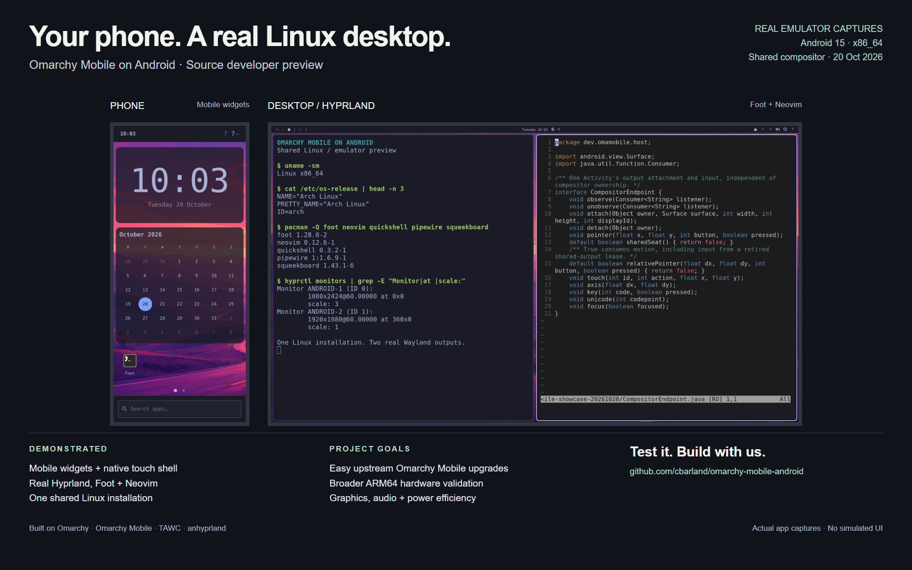

# Android adapter developer preview 2

One shared Linux installation on unmodified Android, with upstream Omarchy Mobile
on the phone and a real Hyprland/Omarchy desktop on an external display. This is
an independent **source developer preview**, not an official Omarchy release.
No root, bootloader unlock, custom kernel, or SELinux changes are required by the
adapter. A public installable graphical APK is not included.

*Real API 35 x86_64 emulator captures, composed without editing the screens.
See [capture context](../media/capture-context.json) and the
[reproducible sharing kit](../media/README.md). Physical-device validation remains
separate.*

The reusable [app-showcase skill](../../.agents/skills/app-showcase/SKILL.md)
captures real applications, preserves original screen pixels and provenance,
and builds a reproducible social graphic with goals and credits outside the UI.

## What changed since preview 1

- **Native phone keyboard:** Mobile's Squeekboard opens for text input; its
  terminal layout sends text and controls through Wayland virtual-keyboard
  events. Keyboard reservation remains on the phone output.
- **Shared mouse seat:** in the opt-in shared compositor preview, a mouse
  captured by the phone can move across both Linux outputs. Clicks, scrolling,
  and typing follow the Linux seat. Returning from Android controls preserves
  external-client focus; Ctrl+Alt+Escape releases capture.
- **Integrated Linux audio output:** one demand-driven PipeWire/Pulse graph feeds
  Android media output, with focus handling, mixing, idle release, and owner
  recovery. Emulator transport tests passed; physical audibility and route
  coverage remain pending, and a Nubia audio-graph exit is unresolved.
- **Recoverable integration updates:** Update Linux integration replaces changed
  adapter-owned payload files with conflict checks and interrupted-update
  recovery. Existing home data and user profiles are preserved. This does not
  establish arbitrary upstream Omarchy/Mobile upgrade compatibility.

Existing preview capabilities include Mobile widgets, genuine Linux terminals,
representative themes/plugins, shared storage binds, Android command integration,
and optional Android windows using separately authorized Shizuku access.
Compatibility is demonstrated for recorded examples, not every plugin or app.

## What was actually verified

The shared-mouse change was exercised on a prepared API 35 x86_64 emulator using
actual Android relative-pointer injection. A real Foot PTY received mouse presses
and releases and keyboard text. Tests covered crossing both outputs, scrolling,
Android focus return, capture release, and external-display removal/recreation.
The separate-desktop mouse regression also passed. The unchanged baseline failed
the new phone-capture check before the fix.

Both native ABIs built. The local source candidate passed 191 host tests; JVM
reported 125 cases with six skips and no failures; lint had no errors and 31
existing warnings. The graphical candidate passed mechanical payload checks,
while retaining all seven publication holds. The prepared emulator's original
files and symlinks were checked after restoration.

On a prepared ARM64 Nubia, the preceding candidate displayed the phone and desktop
shells and accepted native on-screen-keyboard input. After stopping an obsolete
Omalateral input helper, the user confirmed the mouse worked on the phone. The
device was removed before the new shared-seat path could be tested. ARM64 shared
startup had a timeout and still needs investigation. Emulator success does not
establish Bluetooth cross-display behavior, device audio, or power efficiency.

See the detailed [verification record](../VERIFICATION.md#shared-mouse-seat-20-october-2026),
[input contract](../INPUT.md), [audio behavior](../AUDIO.md), and
[update/recovery contract](../PAYLOAD-UPGRADES.md).

## Try it and contribute

Contributors currently need a full graphical source build. The core CI APK cannot
install or display Omarchy. Follow [BUILDING](../BUILDING.md) and
[INSTALLING](../INSTALLING.md); preserve an exported backup before changing an
existing installation. Graphical APK publication remains blocked on seven native
corresponding-source/relinking mappings, the release signing/update path, and the
physical-device gate. See [release readiness](../RELEASE-READINESS.md).

**Testers:** report your device/Android version, ABI, display topology, source
revision, reproduction steps, and focused redacted logs. We particularly need
ARM64 installation, shared-mode startup, Bluetooth input, audio routes, and
reconnect results. Do not clear app storage or uninstall to troubleshoot.

**Developers:** help with upstream-main compatibility and migration tests,
reducing shell patches through upstream extension points, native-source/relink
delivery, graphics acceleration, clipboard/files, and hardware power measurements.
Omarchy Mobile remains pinned at `953bcb3`; this preview does not track upstream
main automatically. Work-profile/Wallet compatibility and microphone capture are
not established.

Start with [CONTRIBUTING](../../CONTRIBUTING.md) and the
[issue tracker](https://github.com/cbarland/omarchy-mobile-android/issues).

## Upstream foundations

This adapter is built on [Omarchy](https://github.com/omacom/omarchy),
[Omarchy Mobile](https://github.com/derekross/omarchy-mobile) by Derek Ross and
contributors, [TAWC](https://github.com/wmww/tawc) by Sophie Winter and contributors,
and [Taowen's Android Hyprland port](https://github.com/taowen/anhyprland), alongside
Hyprland, Aquamarine, Quickshell, Squeekboard, Arch Linux ARM, and the wider
ecosystem. The phone shell and desktop come from upstream; our work is the
Android adapter. See [full credits](../../CREDITS.md).
